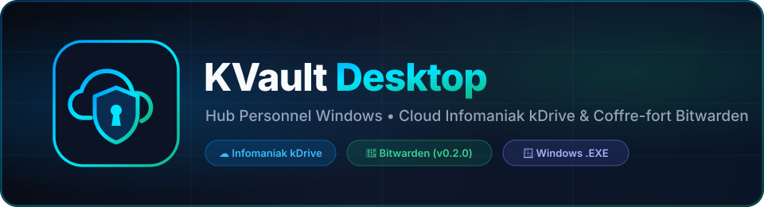

<div align="center">



<br />

[](https://github.com/Akune122/kvault-desktop/releases)
[-0078D6?style=for-the-badge&logo=windows&logoColor=white)](https://github.com/Akune122/kvault-desktop/releases)
[](https://www.electronjs.org/)
[](#1-configuration-infomaniak-kdrive)
[](#2-configuration-bitwarden--vaultwarden)
[](./LICENSE)

<p align="center">
  <strong>Hub personnel sécurisé sur Windows (<code>.exe</code>) réunissant un explorateur &amp; outil de sauvegarde <a href="https://www.infomaniak.com/fr/ksuite/kdrive">Infomaniak kDrive</a> et un gestionnaire de mots de passe <a href="https://bitwarden.com/">Bitwarden / Vaultwarden</a> protégé par code d'accès.</strong>
</p>

</div>

---

## 📥 Téléchargement direct (`.exe` Windows)

<div align="center">

[](https://github.com/Akune122/kvault-desktop/releases/download/v0.2.0/KVault-Desktop-0.2.0-Portable.exe)

</div>

Vous souhaitez utiliser l'application directement sans installer Node.js ?
1. Cliquez sur le bouton ci-dessus ou rendez-vous dans l'onglet **[Releases GitHub](https://github.com/Akune122/kvault-desktop/releases/tag/v0.2.0)** pour télécharger **`KVault-Desktop-0.2.0-Portable.exe`**.
2. Lancez l'exécutable : le **code de déverrouillage initial par défaut est `0000`**.
3. Rendez-vous dans **⚙️ Paramètres & Sécurité** dans l'application pour définir votre propre code/mot de passe et connecter votre **kDrive** ainsi que votre coffre **Bitwarden** !

---

## ✨ Fonctionnalités principales (`v0.2.0`)

| Module | Fonctionnalités incluses |
| :--- | :--- |
| 🛡️ **Verrouillage App (`0000`)** | Écran de verrouillage au démarrage avec pavé numérique + clavier. Code par défaut `0000` (`APP_LOCK_CODE`), modifiable directement dans l'interface par chaque utilisateur du `.exe`. |
| ☁️ **Infomaniak kDrive** | Explorateur complet (API REST officielle `v2`/`v3` + WebDAV), sauvegarde *Drag & Drop* de photos/fichiers/dossiers, visionneuse Lightbox HD, jauge d'espace disque en direct. |
| 🔐 **Coffre Bitwarden** | Déchiffrement 100 % local (`bitwarden.eu`, `bitwarden.com` ou **Vaultwarden**), connexion Clé API ou Email/2FA, recherche rapide, ajout/suppression d'identifiants, codes dynamiques **2FA TOTP**. |
| 📋 **Presse-papiers & Générateur** | Copie rapide des mots de passe avec **purge automatique du presse-papiers après 20 secondes** + générateur cryptographique de mots de passe forts (8 à 64 caractères). |

---

## 🛠️ Installation développeur (Code source)

### Prérequis
- **Windows 10 / 11**
- **[Node.js](https://nodejs.org/)** `v18+` (testé avec `v24`) et `npm`

```powershell
git clone https://github.com/Akune122/kvault-desktop.git
cd kvault-desktop
npm install
Copy-Item .env.example .env
npm start
```

---

## ⚙️ Configuration (`.env` ou Interface de l'application)

Toutes les variables peuvent être renseignées soit dans le fichier **`.env`** (ignoré par Git), soit directement depuis le menu **⚙️ Paramètres & Sécurité** de l'application :

```ini
# Code de verrouillage au lancement de l'application (défaut : 0000)
APP_LOCK_CODE=0000

# --- MODULE 1 : INFOMANIAK KDRIVE ---
KDRIVE_CONNECTION_MODE=api
KDRIVE_ID=123456
KDRIVE_API_TOKEN=votre_token_api_infomaniak

# --- MODULE 2 : BITWARDEN / VAULTWARDEN ---
BITWARDEN_SERVER_URL=https://vault.bitwarden.eu
BITWARDEN_EMAIL=vous@exemple.com
BITWARDEN_CLIENT_ID=user.xxxxxxxx-xxxx-xxxx-xxxx-xxxxxxxxxxxx
BITWARDEN_CLIENT_SECRET=votre_client_secret_bitwarden
```

### 1. Configuration Infomaniak kDrive
- **`KDRIVE_ID`** : ouvrez [kDrive Web](https://ksuite.infomaniak.com/kdrive) et copiez les chiffres situés après `/drive/` dans l'URL (`.../drive/123456/files`).
- **`KDRIVE_API_TOKEN`** : générez un token avec la permission **`drive`** dans [Infomaniak Manager → Tokens API](https://manager.infomaniak.com/v3/ng/profile/user/token/list).

### 2. Configuration Bitwarden / Vaultwarden
- Sur votre coffre web Bitwarden (**Paramètres → Sécurité → Clés → Voir la clé API**), récupérez votre `client_id` et votre `client_secret` *(recommandé : évite les blocages Captcha et fonctionne avec la 2FA)*.
- **Sécurité Zero-Knowledge** : votre **Mot de passe maître Bitwarden** n'est **jamais** stocké dans `.env` ni sur le disque — il vous est demandé uniquement lors du déverrouillage en mémoire vive.

---

## 📦 Générer l'exécutable Windows (`.exe`)

```powershell
npm run build:exe
```

L'exécutable autonome est généré dans :
- `dist/KVault-Desktop-0.2.0-Portable.exe`

---

## 🧱 Architecture du projet

```text
kvault-desktop/
├── assets/
│   ├── banner.svg               # Bannière officielle GitHub
│   ├── icon.png                 # Icône haute résolution Windows (.exe)
│   └── logo.svg                 # Logo vectoriel KVault
├── scripts/
│   ├── ensure-electron.js       # Vérification & extraction du runtime Electron
│   ├── prepare-build.js         # Préparation Windows des outils d'icône (.exe)
│   ├── publish-release.js       # Publication automatisée de Release GitHub + upload .exe
│   └── start-electron.js        # Lanceur propre isolé des variables IDE
├── src/
│   ├── main/
│   │   ├── config.js            # Gestion hybride .env + profil local userData
│   │   ├── main.js              # Processus principal Electron, IPC & sécurité code PIN
│   │   └── preload.js           # Pont ContextBridge sécurisé
│   ├── services/
│   │   ├── bitwarden-service.js # Moteur local chiffré Bitwarden / Vaultwarden
│   │   ├── kdrive-api.js        # Client REST API officiel Infomaniak kDrive (v2/v3)
│   │   ├── kdrive-webdav.js     # Client WebDAV Infomaniak natif
│   │   └── kdrive-manager.js    # Façade multi-protocole kDrive
│   └── renderer/
│       ├── index.html           # Interface Desktop (Lock screen, kDrive, Bitwarden, Settings)
│       ├── styles.css           # Thème Dark Glassmorphism
│       └── app.js               # Logique frontend complète
├── .env.example                 # Modèle de configuration documenté
├── CHANGELOG.md                 # Historique des versions (SemVer)
└── package.json                 # Configuration Electron & electron-builder
```

---

## 🗺️ Feuille de route (Roadmap)

- [x] **`v0.1.0` — Fondation & Connecteur Infomaniak kDrive**
- [x] **`v0.2.0` — Coffre-fort Bitwarden / Vaultwarden & Verrouillage Application (`APP_LOCK_CODE`)**
- [ ] **`v0.3.0` — Synchronisation programmée & Backup chiffré automatique vers kDrive**

---

<div align="center">
  <sub>Développé par <strong>Loïc Zaercher (<a href="https://github.com/Akune122">Akune122</a>)</strong> • Licence <a href="./LICENSE">MIT</a></sub>
</div>
